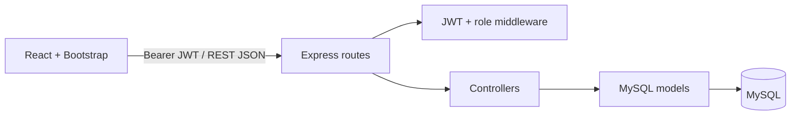
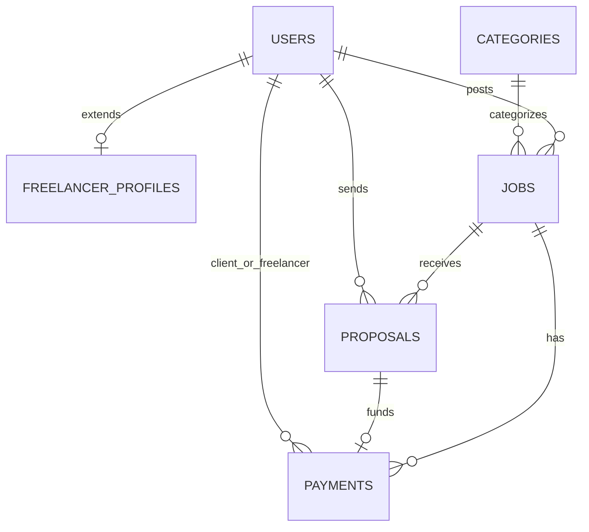

# WorkBridge — Freelance Job Portal

WorkBridge is a portfolio-ready, responsive full-stack marketplace for clients and freelancers. It demonstrates React UI development, a Node/Express REST API, MySQL design, JWT authentication, role-based authorization, CRUD workflows, and a clearly labelled simulated escrow payment lifecycle.

> **Payment safety:** WorkBridge does not accept or process real payments. “Escrow” is a simulated state workflow for demonstration only.

## Features

- Responsive React + Bootstrap experience with landing, jobs, dashboard, and admin views
- Register as a client or freelancer; passwords are hashed with bcrypt
- JWT-protected APIs with client, freelancer, and admin authorization
- Search/filter jobs by keyword, category, experience, and budget
- Client job CRUD, proposal review, freelancer hiring, and job lifecycle states
- Freelancer profile management and proposal create/edit/withdraw flows
- Simulated payment records: **Pending → Escrow Held → Released**
- Admin analytics, user moderation, job moderation, and payment oversight
- Input validation, centralized API errors, loading/empty/success/error UI states
- MySQL schema, seed script, Docker configuration, Render blueprint, and a Postman collection

## Tech stack

| Layer | Technology |
| --- | --- |
| Frontend | React 18, Vite, React Router, Bootstrap 5, CSS3 |
| Backend | Node.js, Express, MVC-style controllers/models/routes |
| Database | MySQL 8, `mysql2` connection pool |
| Auth | JWT, bcryptjs, role middleware |
| API testing | Postman collection in `docs/` |
| Deployment | Docker / Docker Compose, Render blueprint |

## Project structure

```text
workbridge/
├── frontend/                 # Vite React single-page application
│   └── src/
│       ├── components/       # layout, protected routes, reusable UI
│       ├── context/          # authentication state
│       └── pages/            # landing, jobs, dashboards, auth
├── backend/
│   ├── config/               # MySQL pool
│   ├── controllers/          # request / response logic
│   ├── middleware/           # auth, validation, errors
│   ├── models/               # normalized data access
│   ├── routes/               # REST endpoint definitions
│   └── scripts/seed.js       # demo data, generated bcrypt hashes
├── database/schema.sql       # MySQL tables + category seed data
├── docs/WorkBridge.postman_collection.json
├── docker-compose.yml
└── render.yaml
```

## Run locally

### 1. Prerequisites

- Node.js 20+ (Node 18+ should work)
- MySQL 8+
- npm and optionally Postman

### 2. Create the database

Import [`database/schema.sql`](database/schema.sql) with MySQL Workbench or:

```bash
mysql -u root -p < database/schema.sql
```

### 3. Configure and run the API

```bash
cd backend
copy .env.example .env
# Update DB_PASSWORD, JWT_SECRET, and other database values in .env
npm install
npm run seed
npm run dev
```

The API starts at `http://localhost:5000`. Confirm it with `GET /api/health`.

### 4. Configure and run the frontend

In a second terminal:

```bash
cd frontend
copy .env.example .env
npm install
npm run dev
```

Open `http://localhost:5173`.

The sample seed accounts all use **Password123!**:

| Role | Email |
| --- | --- |
| Client | `client@workbridge.dev` |
| Freelancer | `freelancer@workbridge.dev` |
| Admin | `admin@workbridge.dev` |

### Docker option

Docker starts MySQL, API, and web UI together:

```bash
docker compose up --build
```

Open `http://localhost:8080`. Once the stack is ready, run `npm install` then `npm run seed` from `backend/` on the host (or use your preferred one-off container command) to insert the demo users/jobs. Change the sample MySQL root password and JWT secret before using the compose configuration outside local development.

## Architecture

The frontend is a React single-page app. `AuthContext` stores the current user and bearer token; `ProtectedRoute` gates member and admin routes. Pages call a centralized `api()` helper, which adds the JWT and converts API errors into UI states.

The Express backend follows a lightweight MVC separation:

1. **Routes** declare endpoints, request validation, and role requirements.
2. **Controllers** enforce workflow rules and shape HTTP responses.
3. **Models** contain parameterized MySQL queries.
4. **Middleware** verifies JWTs, restricts roles, validates input, and returns centralized errors.



## Database relationships



- `users` holds shared identity, credentials, role, and visible profile fields.
- `freelancer_profiles` extends a freelancer one-to-one for work-specific fields such as availability and earnings.
- Each `job` belongs to one client and one category.
- Each `proposal` connects one freelancer to one job; `(job_id, freelancer_id)` is unique.
- Each `payment` references the job, accepted proposal, client, and freelancer. A proposal can have one payment record.

All tables use primary keys, foreign keys, timestamps, status fields, and relevant indexes. See [`database/schema.sql`](database/schema.sql) for the complete importable definition.

## Authentication and authorization

1. A user submits registration credentials and a client/freelancer role.
2. The API validates data, hashes the password with bcrypt, and stores only `password_hash`.
3. Login compares bcrypt hashes and returns a signed JWT with the user id.
4. The React API helper sends `Authorization: Bearer <token>` on protected calls.
5. `protect` verifies the JWT and loads an active user; `allowRoles(...)` enforces permissions.

| Action | Freelancer | Client | Admin |
| --- | :---: | :---: | :---: |
| Browse jobs | ✓ | ✓ | ✓ |
| Edit own profile | ✓ | ✓ | ✓ |
| Post/edit/delete own jobs | — | ✓ | ✓ |
| Create/edit/withdraw own proposal | ✓ | — | — |
| Review/hire job proposals | — | ✓ | ✓ |
| Create/release own escrow record | — | ✓ | ✓ |
| Moderate users, jobs, all payments | — | — | ✓ |

## Simulated escrow workflow

1. A client accepts a proposal. The job moves to `in_progress`; outstanding proposals are rejected.
2. The client creates a payment record linked to that accepted proposal with status `pending`.
3. The client marks it `escrow_held` to simulate funding the hold.
4. When work is accepted, the client marks it `released` to simulate payout.
5. Admins can inspect or override all records for support/moderation.

The API blocks client-side status skipping: a client may only move `pending → escrow_held → released`. No payment gateway, card details, or actual transfer is involved.

## API reference

All protected endpoints require `Authorization: Bearer <token>`.

| Method | Endpoint | Access | Purpose |
| --- | --- | --- | --- |
| POST | `/api/auth/register` | Public | Register client/freelancer |
| POST | `/api/auth/login` | Public | Log in and receive JWT |
| GET | `/api/auth/me` | Signed in | Get current user |
| GET/PATCH | `/api/users/profile` | Signed in | Read/update profile |
| GET | `/api/jobs` | Public | List/search/filter open jobs |
| GET/POST | `/api/jobs` | Public / Client | List or post jobs |
| GET/PATCH/DELETE | `/api/jobs/:id` | Public / Owner/Admin | Read/manage a job |
| GET/POST | `/api/jobs/:id/proposals` | Owner/Admin / Freelancer | Read or submit proposals |
| GET | `/api/proposals/mine` | Freelancer | Own proposal list |
| PATCH/DELETE | `/api/proposals/:id` | Proposal owner | Edit/withdraw pending proposal |
| PATCH | `/api/proposals/:id/status` | Client/Admin | Accept or reject proposal |
| GET/POST | `/api/payments` | Signed in / Client | List or create escrow records |
| PATCH | `/api/payments/:id/status` | Client/Admin | Move simulated payment state |
| GET | `/api/admin/dashboard` | Admin | Totals and category analytics |
| GET/PATCH | `/api/admin/users` | Admin | List/moderate users |
| GET | `/api/admin/jobs` | Admin | List all job posts |

Import [`docs/WorkBridge.postman_collection.json`](docs/WorkBridge.postman_collection.json) into Postman. Log in first, paste the returned token into the collection variable `token`, then exercise protected endpoints.

## Deployment

### Docker

For a full environment on any Docker-capable host, configure secure values in `docker-compose.yml` or a compose override, then run `docker compose up --build`. The frontend container is served by Nginx; the SPA fallback is configured in [`frontend/nginx.conf`](frontend/nginx.conf).

### Render + managed MySQL

1. Push this repository to GitHub.
2. Create a managed MySQL 8 database with a provider such as Aiven, DigitalOcean, Railway, or AWS RDS. Import `database/schema.sql`, then run `backend/scripts/seed.js` once if demo data is wanted.
3. In Render, choose **New → Blueprint** and select this repository. [`render.yaml`](render.yaml) creates the Node API and static React service.
4. Set the API service values: `DB_HOST`, `DB_USER`, `DB_PASSWORD`, `DB_NAME`, and `CLIENT_URL` (the public static-site URL). Render generates `JWT_SECRET`.
5. Set `VITE_API_URL` on the static service to `https://<your-api-service>.onrender.com/api`, then redeploy that static service. Vite embeds this value at build time.
6. Set the final frontend URL in the API’s `CLIENT_URL` and redeploy API. Check `/api/health`, then register/login in the deployed website.

For a Vercel frontend alternative, import the `frontend/` directory as the project root, set `VITE_API_URL` to the deployed API URL plus `/api`, and use the existing SPA app structure. The backend can remain on Render, Railway, Fly.io, or any Node host with environment variables.

## Screenshot placeholders

Add portfolio screenshots here after running the app:

- `docs/screenshots/home.png` — hero, categories, featured jobs
- `docs/screenshots/jobs.png` — search/filter results and cards
- `docs/screenshots/client-dashboard.png` — posted projects and proposals
- `docs/screenshots/admin-dashboard.png` — analytics and moderation

## Future improvements

- Socket.IO real-time messages and proposal notifications
- Cloudinary/S3 file uploads for portfolios, avatars, and project attachments
- Email/push notifications with background jobs
- Stripe Connect or Razorpay Marketplace with webhooks and real escrow/compliance design
- Pagination, saved jobs, ratings/reviews, dispute workflows, and audit logs
- React Hook Form/Zod, automated API/UI tests, rate limiting, Redis caching, and CI/CD
- Production observability: structured logs, health alerts, database backups, and secret rotation

